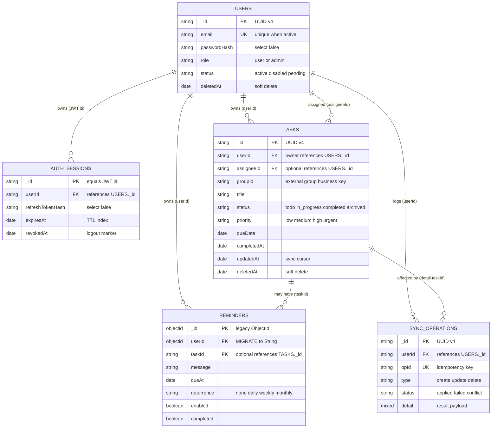

# 7.5 Database Design

## Scope and grounding

This section specifies the MongoDB Atlas database design for **Auxilia – Personal Secretary & Task Automation Assistant**. The design is derived from the implemented backend modules (`backend/src/modules/{auth,users,tasks,reminders,sync,analytics}`) and the existing ERD in `docs/architecture/ERD.md`. It covers the five collections that support the core functional scope of this brief:

1. Authentication and account lifecycle (`users`, `authsessions`)
2. Task management (`tasks`)
3. Reminders (`reminders`)
4. Offline-first synchronisation (`syncoperations`)
5. Productivity tracking (**derived from `tasks`; no dedicated collection**)

Adjacent collections that exist in the wider Auxilia system (groups, members, invitations, calendar events, roadmaps, rubrics, study sessions, audit events, feedback) are **not** specified here because they fall outside the stated scope. They are referenced only where a field (for example `Task.groupId`) is itself part of the core task record. No speculative collections have been introduced.

**Design principles.** Identifiers are String UUIDs so that the same identifier can travel from the Flutter client through JWT claims into every collection without ObjectId conversion — with one documented legacy exception (`Reminder.userId`, see §7.5.1). Relationships are logical references maintained by the Controller–Service–Repository layers; MongoDB does not enforce foreign keys. Writes are constrained by Mongoose validators, and cross-document ownership, concurrency and conflict rules are enforced in application logic.

---

## 7.5.1 Database Collections

### Collection summary

| # | Collection | Purpose | Primary identifier | Ownership | Approx. cardinality per user |
|---|---|---|---|---|---|
| 1 | `users` | Identity, sign-in credentials, multi-factor verification state, account status | String UUID (`_id`) | Self | 1 |
| 2 | `authsessions` | One signed-in device; JWT `jti` and refresh-token rotation state | String UUID (`_id`, = JWT `jti`) | `userId` → `users._id` | 0..n devices |
| 3 | `tasks` | Personal and assigned tasks, deadlines, status, priority | String UUID (`_id`) | `userId` (owner), optional `assigneeId` | 0..n |
| 4 | `reminders` | In-app reminder schedule, optionally linked to a task | ObjectId (`_id`, legacy) | `userId`, optional `taskId` | 0..n |
| 5 | `syncoperations` | Append-only idempotency/conflict ledger for offline sync pushes | String UUID (`_id`) | `userId` | 0..n |

`Field type` notation follows Mongoose schema types. "Required" means required by the Mongoose schema unless stated otherwise. All collections use `timestamps: true` (`createdAt`, `updatedAt`) and `versionKey: false`.

### 7.5.1.1 `users`

**Purpose:** Store the authoritative identity and security state for an Auxilia account. The document is shared by the authentication and user-profile modules.

| Field | Type | Required | Default | Constraints / validation | Description |
|---|---|---|---|---|---|
| `_id` | String (UUID v4) | Yes | `randomUUID()` | Immutable, primary key | Stable identifier referenced by every other collection. |
| `name` | String | No | — | `trim`, length 2–80 | Display name; optional because the sign-up path may omit it. |
| `email` | String | Yes | — | `lowercase`, `trim`, ≤ 254 chars, regex format; **partial unique** where `deletedAt: null` | Login identifier; unique among active accounts. |
| `passwordHash` | String | Yes | — | `select: false`, stripped from `toJSON` | Salted password hash; raw passwords are never persisted. |
| `role` | String enum | Yes | `"user"` | `enum: ["user","admin"]` | Authorisation role; not client-settable. |
| `status` | String enum | Yes | `"pending"` | `enum: ["active","disabled","pending"]` | Administrative account state; admin-service controlled only. |
| `emailVerifiedAt` | Date \| null | No | `null` | — | Time of successful email verification. |
| `emailVerificationTokenHash` | String \| null | No | `null` | `select: false`, sparse index | Hash of verification token only. |
| `emailVerificationExpiresAt` | Date \| null | No | `null` | — | Expiry of the verification token. |
| `mfaEnabled` | Boolean | No | `false` | — | TOTP enrolment flag. |
| `mfaSecretEncrypted` | String \| null | No | `null` | `select: false` | Encrypted TOTP secret; never returned by API. |
| `mfaPendingSecretEncrypted` | String \| null | No | `null` | `select: false` | Encrypted secret awaiting confirmation. |
| `mfaPendingExpiresAt` | Date \| null | No | `null` | — | Expiry of pending enrolment. |
| `mfaRecoveryCodeHashes` | String[] | No | `[]` | `select: false` | Hashed one-time recovery codes. |
| `mfaLastUsedStep` | Number \| null | No | `null` | `select: false` | Last accepted TOTP counter, prevents replay. |
| `mfaEnabledAt` | Date \| null | No | `null` | — | Enrolment completion time. |
| `passwordResetTokenHash` | String \| null | No | `null` | `select: false` | Hash of password-reset token. |
| `passwordResetExpiresAt` | Date \| null | No | `null` | — | Reset token expiry. |
| `lastLoginAt` | Date \| null | No | `null` | — | Audit convenience field. |
| `deletedAt` | Date \| null | No | `null` | Soft-delete marker; drives partial unique email index | Soft-deleted accounts are excluded from normal queries. |
| `failedLoginAttempts` | Number | No | `0` | `min: 0` | Brute-force counter. |
| `lockoutUntil` | Date \| null | No | `null` | — | Temporary lock expiry. |
| `createdAt`, `updatedAt` | Date | Yes | Generated | `timestamps: true` | Record lifecycle timestamps. |

**Embedded vs referenced:** All fields are scalar or value arrays; there are no embedded documents. Security fields use `select: false` plus a `toJSON` transform as a defence-in-depth measure. No sub-collection is justified for one-to-one security state.

### 7.5.1.2 `authsessions`

**Purpose:** Represent one signed-in device. The document `_id` doubles as the JWT `jti`, so an access token maps to its session in a single point lookup, and the refresh secret can be rotated without writing to `users`.

| Field | Type | Required | Default | Constraints / validation | Description |
|---|---|---|---|---|---|
| `_id` | String (UUID) | Yes | Supplied by auth service | Primary key; equals JWT `jti` | Session/token identifier. |
| `userId` | String | Yes | — | Indexed; logical reference to `users._id` | Session owner. |
| `refreshTokenHash` | String \| null | No | `null` | `select: false` | SHA-256 of current refresh secret. |
| `previousRefreshTokenHash` | String \| null | No | `null` | `select: false` | Previous secret for reuse-detection grace window. |
| `refreshedAt` | Date \| null | No | `null` | — | Start of the rotation grace window. |
| `userAgent` | String \| null | No | `null` | ≤ 255 chars | Device description for the device list. |
| `lastUsedAt` | Date | No | `Date.now` | — | Last authenticated request time. |
| `expiresAt` | Date | Yes | — | **TTL index** `expireAfterSeconds: 0` | Automatic session expiry and cleanup. |
| `revokedAt` | Date \| null | No | `null` | — | Explicit logout/revocation marker. |
| `createdAt`, `updatedAt` | Date | Yes | Generated | `timestamps: true` | Lifecycle timestamps. |

**Embedded vs referenced:** `userId` is a String reference; no user data is duplicated into the session.

### 7.5.1.3 `tasks`

**Purpose:** Central task record for personal and group-assigned work. It is also the sole source for productivity analytics and the offline change feed.

| Field | Type | Required | Default | Constraints / validation | Description |
|---|---|---|---|---|---|
| `_id` | String (UUID v4) | Yes | `randomUUID()` | Immutable, primary key; client may supply UUID on create for offline idempotency | Task identifier. |
| `userId` | String | Yes | — | Immutable; logical reference to `users._id` | Owner assigned from the JWT, never from the request body. |
| `title` | String | Yes | — | `trim`, length 1–150 | Task title. |
| `description` | String \| null | No | `null` | ≤ 5000 chars | Longer description. |
| `course` | String | No | `""` | `trim`, ≤ 120 chars | Optional course/module label. |
| `tags` | String[] | No | `[]` | Application caps at 8 tags, 24 chars each, case-insensitive de-duplication | Lightweight labels. |
| `groupId` | String \| null | No | `null` | Logical reference to `groups.groupId` (business key) | Optional group workspace. |
| `assigneeId` | String \| null | No | `null` | Logical reference to `users._id` | Optional assigned member; included in the sync change feed. |
| `assigneeName` | String \| null | No | `null` | `trim`, ≤ 120 chars | Denormalised display name for offline rendering. |
| `reminderAt` | Date \| null | No | `null` | — | Inline reminder hint on the task. |
| `status` | String enum | Yes | `"todo"` | `enum: ["todo","in_progress","completed","archived"]` | Lifecycle state. |
| `priority` | String enum | Yes | `"medium"` | `enum: ["low","medium","high","urgent"]` | User-selected priority. |
| `dueDate` | Date \| null | No | `null` | — | Deadline used for dashboard and overdue queries. |
| `completedAt` | Date \| null | No | `null` | Maintained by pre-save / pre-update hooks | Set when status transitions to `completed`, cleared otherwise. |
| `deletedAt` | Date \| null | No | `null` | `select: false`, removed from `toJSON`; soft delete | Excluded from normal queries; included in sync change feed. |
| `createdAt`, `updatedAt` | Date | Yes | Generated | `timestamps: true`; `updatedAt` doubles as sync cursor and CAS token | Lifecycle/change-feed timestamps. |

**Embedded vs referenced:** Tags are an embedded value array (small, bounded, always read with the task). Group and assignee are references by business/UUID key, not embedded user/group documents, to avoid stale copies. `assigneeName` is the single deliberate denormalisation so the Flutter client can render assigned tasks offline.

### 7.5.1.4 `reminders`

**Purpose:** Persist in-app reminder schedules, optionally attached to a task. Reminders are in-app only; no push-notification delivery record is stored in this scope.

| Field | Type | Required | Default | Constraints / validation | Description |
|---|---|---|---|---|---|
| `_id` | ObjectId | Yes | Generated by MongoDB | Primary key (legacy choice; see note) | Reminder identifier. |
| `userId` | ObjectId → `users._id` *(as implemented)* | Yes | — | `ref: "User"` | Owner. **Type-inconsistency defect:** `users._id` is a String UUID, so this cannot be resolved by direct lookup/population (see note). |
| `taskId` | String \| null | No | `null` | Indexed; UUID of a `tasks._id`; validated as UUID by Zod | Optional task link. |
| `message` | String | Yes | — | `trim`, ≤ 500 chars | Reminder text. |
| `dueAt` | Date | Yes | — | — | Scheduled fire time; queried for upcoming reminders. |
| `recurrence` | String enum | No | `"none"` | `enum: ["none","daily","weekly","monthly"]` | Recurrence rule; advancement is application logic. |
| `enabled` | Boolean | No | `true` | — | Allows snooze/deactivation without deletion. |
| `completed` | Boolean | No | `false` | — | Marks a reminder as handled. |
| `completedAt` | Date | No | — | — | Time of completion. |
| `createdAt`, `updatedAt` | Date | Yes | Generated | `timestamps: true` | Lifecycle timestamps. |

> **Design note — identifier correction (required migration, not a new feature).** The committed schema uses `ObjectId` for `Reminder.userId` (and an auto `ObjectId` `_id`), while `users._id` and `tasks._id` are String UUIDs. The target design is `userId: String` referencing `users._id` and, for consistency across the core collections, a String UUID `_id`. Until the data migration is performed, reminder-to-user lookups must be performed with explicit string conversion in the service layer and `populate()` must not be assumed to work. This defect is recorded in `docs/architecture/ERD.md` (technical note 4).

**Embedded vs referenced:** The optional `taskId` is a String reference. Recurrence is stored as an enum plus a scalar `dueAt`, not as a complex embedded schedule object, which keeps the schema aligned with the current in-app reminder feature.

### 7.5.1.5 `syncoperations`

**Purpose:** Append-only idempotency ledger for offline sync operations pushed by the Flutter client. One document per `(userId, opId)`; replayed operations return the stored result instead of re-applying the mutation.

| Field | Type | Required | Default | Constraints / validation | Description |
|---|---|---|---|---|---|
| `_id` | String (UUID v4) | Yes | `randomUUID()` | Primary key | Ledger entry identifier. |
| `userId` | String | Yes | — | Part of compound unique key; logical reference to `users._id` | Owner; derived from JWT. |
| `opId` | String (UUID) | Yes | — | Part of **compound unique** key; UUID validated by Zod | Client-generated idempotency key. |
| `type` | String enum | Yes | — | `enum: ["task.create","task.update","task.delete"]` | Operation kind. |
| `status` | String enum | Yes | — | `enum: ["applied","failed","conflict"]` | Outcome of the operation. |
| `detail` | Mixed (JSON) | No | `null` | Application rule: never store secrets here | Result payload (e.g. `{ taskId, updatedAt }` or `{ code }`). |
| `createdAt`, `updatedAt` | Date | Yes | Generated | `timestamps: true` | Ledger timestamps; `createdAt` is a candidate retention key. |

**Embedded vs referenced:** The result is an embedded `Mixed` payload rather than a separate collection because it is only ever read with the ledger entry. The collection is intentionally small and append-only.

### 7.5.1.6 Productivity tracking — no collection

Productivity metrics (task totals, completion rate, due-today and overdue counts, daily/weekly completion buckets, completion streaks) are **computed on demand** by the analytics service from `tasks` fields (`status`, `createdAt`, `completedAt`, `dueDate`) with `countDocuments` and aggregation queries, and cached in Redis. Introducing a `ProductivitySnapshot`/`Stats` collection would duplicate derivable data and create invalidity whenever a task changes. Therefore **no collection is created** for productivity tracking in this design. This is a justified omission, not an oversight; see §7.5.6 for the conditional case in which a materialised snapshot could be introduced later.

---

## 7.5.2 Relationships

### Relationship description

| Relationship | Type | Implementation | Cardinality | Integrity owner |
|---|---|---|---|---|
| `users` → `authsessions` | One-to-many | `authsessions.userId` String reference | 1 : 0..n | Auth service; session queries always scoped by `userId` from JWT |
| `users` → `tasks` (ownership) | One-to-many | `tasks.userId` String reference, immutable | 1 : 0..n | Task repository applies `{ userId, deletedAt: null }` to every query |
| `users` → `tasks` (assignment) | One-to-many, optional | `tasks.assigneeId` String reference | 1 : 0..n | Task service; change feed includes `$or: [{userId},{assigneeId}]` |
| `tasks` → `reminders` | One-to-many, optional | `reminders.taskId` String reference | 1 : 0..n | Reminder service verifies task ownership before linking |
| `users` → `reminders` | One-to-many | `reminders.userId` reference (target type to be corrected to String) | 1 : 0..n | Reminder repository scopes by authenticated `userId` |
| `users` → `syncoperations` | One-to-many | `syncoperations.userId` String reference | 1 : 0..n | Sync service; `userId` always from JWT |
| `syncoperations` → `tasks` | Logical, indirect | `detail.taskId` payload only | n : 0..1 | No DB reference; operation result records the affected task |

**Cardinality and ownership rules.**

- Every owned collection carries a `userId`. It is populated exclusively from the verified JWT subject, never from client input, so a client cannot create or read another user's data. `Task.userId` is additionally `immutable`.
- There are **no database-enforced foreign keys**. MongoDB does not provide them and Mongoose `ref` is only a `populate()` hint. Referential integrity is a service-layer responsibility: the owning document's existence and ownership are checked before mutation, and delete operations are soft deletes that never leave dangling hard references.
- `tasks.groupId` references the `groups.groupId` **business key**, not a group `_id`. It is shown as an external logical reference in the diagram and is outside this design's collection set.
- Removal of a `users` document is a soft delete (`deletedAt`), so owned tasks remain addressable for sync/reconciliation. No cascading hard deletes exist.

### Relationship diagram

Mermaid ERD is used because all relationships in this design reduce to document references with well-defined cardinality. Polymorphic/external references are shown as dashed or labelled relationships.



*Notation:* `||` = exactly one, `o{` = zero or many. `UK` on `SYNC_OPERATIONS.opId` is a compound uniqueness constraint with `userId`. The `TASKS.groupId` attribute is an external logical reference to a collection outside this design's scope.

---

## 7.5.3 Constraints

### 7.5.3.1 Database / Mongoose-enforced constraints

| Collection | Constraint | Mechanism |
|---|---|---|
| `users` | `_id` cannot change; String UUID | `immutable: true`, default `randomUUID()` |
| `users` | Email required, format-valid, normalised | `required`, `match` regex, `lowercase`, `trim`, `maxlength: 254` |
| `users` | One active account per email | Unique index with `partialFilterExpression: { deletedAt: null }` |
| `users` | Enum-valued role/status | `enum: USER_ROLES` / `enum: USER_STATUSES` |
| `users` | Secret fields not returned by queries or JSON | `select: false` + `toJSON.transform` deletion |
| `users` | Failed-attempt counter non-negative | `min: 0` |
| `users` | Undefined fields rejected | `strict: "throw"` |
| `authsessions` | `expiresAt` required; automatic expiry | `required: true`; TTL index `expireAfterSeconds: 0` |
| `authsessions` | Token lookup by `jti` | `_id` is the JWT id (implicit unique) |
| `tasks` | Immutable identifier and owner | `_id`, `userId`: `immutable: true` |
| `tasks` | Title bounds; description/course length | `required`, `trim`, `minlength/maxlength` (1–150, ≤ 5000, ≤ 120) |
| `tasks` | Status/priority restricted | `enum: TASK_STATUSES` / `enum: TASK_PRIORITIES` with defaults |
| `tasks` | Soft-deleted rows hidden by default | `deletedAt` with `select: false`, removed in `toJSON` |
| `tasks` | No unknown fields persisted | `strict: "throw"` |
| `tasks` | `completedAt` consistency | Pre-`save` and pre-`findOneAndUpdate` hooks maintain the field on status transition |
| `reminders` | Message bounds, due time required | `required`, `trim`, `maxlength: 500`; `dueAt: required` |
| `reminders` | Recurrence domain | `enum: REMINDER_RECURRENCES`, default `"none"` |
| `syncoperations` | Idempotency per user/op | Compound unique index `(userId, opId)` |
| `syncoperations` | Operation and outcome domains | `enum` on `type` and `status` |

### 7.5.3.2 Application-level constraints (not enforced by MongoDB)

| Area | Rule | Enforced by |
|---|---|---|
| Ownership | `userId` is taken from the JWT; all reads/writes are scoped to it; task owner and assignee are verified before mutation | Auth middleware, task/reminder services and repositories |
| Identifier consistency | `Task._id`, `assigneeId`, `taskId` and sync `opId` are validated as UUIDs; `groupId` as a business key | Zod request schemas (`task.validation.ts`, `sync.validation.ts`, `reminder.validation.ts`) |
| Tags | At most 8 tags, ≤ 24 chars each, trimmed, case-insensitively de-duplicated | Zod `transform` in `task.validation.ts` (schema stores only bounded array shape) |
| Optimistic concurrency | `expectedUpdatedAt` is compared with the persisted `updatedAt`; mismatch → `409 TASK_CONFLICT` | Task service (compare-and-swap) |
| Sync idempotency | Duplicate `(userId, opId)` returns the stored result; unique-index error `11000` is treated as a replay | Sync service with `SyncOperation` ledger |
| Sync failure classification | `TASK_CONFLICT` → `status: "conflict"`; `404` → `status: "failed"`; otherwise propagate | `sync.service.ts` |
| Conflict resolution | `resolution: "client"` requires `clientState`; `"server"` returns authoritative state without overwriting | Zod `refine` + sync service |
| Date validation | `dueDate`/`reminderAt` accept date or null; application may reject dates outside a sensible window before persistence | Zod coercion and service rules |
| Recurrence | Recurrence arithmetic (advancing `dueAt` after a recurring reminder is completed) is performed in the reminder service; MongoDB stores only the enum and current `dueAt` | Reminder service |
| Soft deletion | Deletes set `deletedAt`; subsequent queries exclude them unless explicitly requested (`includeDeleted`, sync feed) | Repository query filters |
| Secret content | Token hashes, MFA secrets and sync `detail` never contain plaintext secrets | Service-layer construction rules |

### 7.5.3.3 Deletion behaviour and duplicate/invalid data

- **Users:** soft delete via `deletedAt`. The partial unique index frees the email for re-registration. Sessions are expired independently by their TTL index.
- **Tasks:** soft delete via `deletedAt`; `updatedAt` advances so offline clients receive the deletion through the change feed. No hard cascade to reminders; reminder queries filter by the linked task's active state in the service layer.
- **Reminders and `syncoperations`:** no soft delete; reminders are disabled/completed instead of deleted where appropriate. The sync ledger is append-only and must not be mutated because replays depend on the stored result.
- **Duplicate data:** active-user email duplicates are rejected by the partial unique index; sync `opId` replays are absorbed by the compound unique index; duplicate tags are removed before persistence.
- **Invalid data:** unknown fields are rejected on users/tasks (`strict: "throw"`); all externally supplied payloads pass Zod validation before reaching Mongoose; Mongoose validators provide a second line of defence.

---

## 7.5.4 Indexing Strategy

Indexes are chosen from the actual query patterns. Write-heavy collections (`tasks`, `syncoperations`) carry only indexes that support a required access path; overlapping optional indexes are identified so they can be dropped if write cost becomes significant.

### 7.5.4.1 `users`

| Index (fields) | Type | Name | Query / operation optimised | Justification | Status |
|---|---|---|---|---|---|
| `{ email: 1 }` + partial filter `{ deletedAt: null }` | Unique, partial | `uq_users_active_email` | Login lookup, registration uniqueness | Enforces one active account per email while allowing re-registration after soft delete | **Required** |
| `{ emailVerificationTokenHash: 1 }` | Single, sparse | `ix_users_email_verification_token` | Email verification token lookup | Field is `select: false`; verification needs a direct indexed lookup | **Required** |
| `{ status: 1, createdAt: -1 }` | Compound | `ix_users_status_created_at` | Admin list by account status | Administrative filtering/sorting | Optional |
| `{ role: 1, createdAt: -1 }` | Compound | `ix_users_role_created_at` | Admin list by role | Administrative filtering/sorting | Optional |
| `{ passwordResetTokenHash: 1 }` | Single, sparse | — | Password-reset token lookup | Recommended addition: avoids a collection scan on reset | Recommended |

### 7.5.4.2 `tasks`

| Index (fields) | Type | Name | Query / operation optimised | Justification | Status |
|---|---|---|---|---|---|
| `{ userId: 1, deletedAt: 1, createdAt: -1 }` | Compound | `ix_tasks_user_active_created` | Default "my tasks" list, newest first | Primary task-listing path; prefix matches all user-scoped queries | **Required** |
| `{ userId: 1, deletedAt: 1, status: 1, dueDate: 1 }` | Compound | `ix_tasks_user_active_status_due` | Dashboard status filters, due-today/overdue queries | Serves status + due-date range filters without scanning | **Required** |
| `{ userId: 1, deletedAt: 1, priority: 1, createdAt: -1 }` | Compound | `ix_tasks_user_active_priority_created` | Priority-filtered listing | Supports priority filtering; overlaps index 1 — drop if write overhead matters | Optional |
| `{ userId: 1, title: "text", description: "text" }` | Text (weighted 10 / 2) | `ix_tasks_user_text_search` | User-scoped full-text search | Keeps search scoped to one user; `userId` prefix prevents cross-user matches | **Required if search enabled** |
| `{ userId: 1, updatedAt: -1 }` | Compound | `ix_sync_tasks_owner_updated` | Change feed: `{ userId, updatedAt: { $gt: since } }` | Sync pull is a range scan on `updatedAt` after a user equality prefix | **Required** |
| `{ assigneeId: 1, updatedAt: -1 }` | Compound | `ix_sync_tasks_assignee_updated` | Change feed branch `{ assigneeId, updatedAt > since }` | The feed uses `$or`; this index lets MongoDB serve the assignee branch instead of scanning | **Required where assignment is used** |

> The two sync indexes are additions to the committed schema. Without them, `getChangesSince` degrades to a collection scan as task volume grows.

### 7.5.4.3 `reminders`

| Index (fields) | Type | Name | Query / operation optimised | Justification | Status |
|---|---|---|---|---|---|
| `{ userId: 1, dueAt: 1 }` | Compound | — | Upcoming reminders for a user | Prefix-serves due-time ordering; overlaps the two indexes below | Optional |
| `{ userId: 1, completed: 1, dueAt: 1 }` | Compound | — | Open vs completed reminder lists | Supports the common "not completed, soonest first" filter | **Required** |
| `{ userId: 1, enabled: 1, dueAt: 1 }` | Compound | — | Enabled schedule scan / reminder dispatch | Serves the scheduler's due-and-enabled query | **Required** |
| `{ taskId: 1, userId: 1 }` | Compound | — | Reminders attached to a task | Supports "reminders for this task" scoped to its owner | **Required** |
| `{ taskId: 1 }` (from `index: true` on field) | Single | — | Same as above | Redundant with the compound index; remove to reduce write overhead | Remove |

### 7.5.4.4 `authsessions`

| Index (fields) | Type | Name | Query / operation optimised | Justification | Status |
|---|---|---|---|---|---|
| `{ expiresAt: 1 }` | TTL (`expireAfterSeconds: 0`) | — | Automatic deletion of expired sessions | Prevents unbounded growth and enforces session lifetime | **Required** |
| `{ userId: 1, createdAt: -1 }` | Compound | — | Device list per user, newest first | Common account-security view | Optional |
| `_id` | Implicit unique | `_id_` | Token → session lookup by JWT `jti` | Automatic primary-key index; no extra index needed | **Required (implicit)** |

### 7.5.4.5 `syncoperations`

| Index (fields) | Type | Name | Query / operation optimised | Justification | Status |
|---|---|---|---|---|---|
| `{ userId: 1, opId: 1 }` | Compound unique | — | Idempotency check and ledger insert | Guarantees one result per client operation and resolves insert races via code `11000` | **Required** |
| `{ createdAt: 1 }` | TTL (future) | — | Ledger retention pruning | Would bound ledger growth; not implemented in core scope | Optional / future |

### 7.5.4.6 Example Mongoose index definitions

```ts
// users
userSchema.index(
  { email: 1 },
  { name: "uq_users_active_email", unique: true,
    partialFilterExpression: { deletedAt: null } }
);
userSchema.index(
  { emailVerificationTokenHash: 1 },
  { name: "ix_users_email_verification_token", sparse: true }
);
userSchema.index({ status: 1, createdAt: -1 }, { name: "ix_users_status_created_at" });
userSchema.index({ role: 1, createdAt: -1 }, { name: "ix_users_role_created_at" });
// Recommended: userSchema.index({ passwordResetTokenHash: 1 }, { sparse: true });

// tasks
taskSchema.index(
  { userId: 1, deletedAt: 1, createdAt: -1 },
  { name: "ix_tasks_user_active_created" }
);
taskSchema.index(
  { userId: 1, deletedAt: 1, status: 1, dueDate: 1 },
  { name: "ix_tasks_user_active_status_due" }
);
taskSchema.index(
  { userId: 1, deletedAt: 1, priority: 1, createdAt: -1 },
  { name: "ix_tasks_user_active_priority_created" }
);
taskSchema.index(
  { userId: 1, title: "text", description: "text" },
  { name: "ix_tasks_user_text_search", weights: { title: 10, description: 2 } }
);
// Required additions for the offline change feed:
taskSchema.index({ userId: 1, updatedAt: -1 }, { name: "ix_sync_tasks_owner_updated" });
taskSchema.index({ assigneeId: 1, updatedAt: -1 }, { name: "ix_sync_tasks_assignee_updated" });

// reminders
reminderSchema.index({ userId: 1, dueAt: 1 });
reminderSchema.index({ userId: 1, completed: 1, dueAt: 1 });
reminderSchema.index({ userId: 1, enabled: 1, dueAt: 1 });
reminderSchema.index({ taskId: 1, userId: 1 });
// Remove the redundant single-field taskId index (field-level `index: true`).

// authsessions
AuthSessionSchema.index({ expiresAt: 1 }, { expireAfterSeconds: 0 });
AuthSessionSchema.index({ userId: 1, createdAt: -1 });

// syncoperations
syncOperationSchema.index({ userId: 1, opId: 1 }, { unique: true });
```

**Write-overhead note.** Every additional index is maintained on each insert and update. The optional indexes (admin filters, priority listing, device list, standalone `userId`/`dueAt` reminder index) should be retained only while their queries appear in production profiling; the required indexes above have a direct, documented query path.

---

## 7.5.5 Mongoose Schema Definitions (TypeScript-style pseudocode)

The following is schema structure only, not application code.

```ts
// ───────────────────────── users ─────────────────────────
const userSchema = new Schema<UserRecord>({
  _id:     { type: String, default: () => randomUUID(), immutable: true },
  name:    { type: String, trim: true, minlength: 2, maxlength: 80 },
  email:   { type: String, required: true, lowercase: true, trim: true,
             maxlength: 254, match: EMAIL_REGEX },
  passwordHash: { type: String, required: true, select: false },
  role:    { type: String, enum: ["user", "admin"], default: "user", required: true },
  status:  { type: String, enum: ["active", "disabled", "pending"],
             default: "pending", required: true },

  emailVerifiedAt:             { type: Date,   default: null },
  emailVerificationTokenHash:  { type: String, default: null, select: false },
  emailVerificationExpiresAt:  { type: Date,   default: null },

  mfaEnabled:               { type: Boolean, default: false },
  mfaSecretEncrypted:       { type: String,  default: null, select: false },
  mfaPendingSecretEncrypted:{ type: String,  default: null, select: false },
  mfaPendingExpiresAt:      { type: Date,    default: null },
  mfaRecoveryCodeHashes:    { type: [String], default: [], select: false },
  mfaLastUsedStep:          { type: Number,  default: null, select: false },
  mfaEnabledAt:             { type: Date,    default: null },

  passwordResetTokenHash:   { type: String, default: null, select: false },
  passwordResetExpiresAt:   { type: Date,   default: null },
  lastLoginAt:              { type: Date,   default: null },
  deletedAt:                { type: Date,   default: null },
  failedLoginAttempts:      { type: Number, default: 0, min: 0 },
  lockoutUntil:             { type: Date,   default: null },
}, {
  timestamps: true, versionKey: false, strict: "throw",
  toJSON: { transform: stripSecurityFields }
});
// indexes: see §7.5.4.6

// ─────────────────────── authsessions ───────────────────────
const authSessionSchema = new Schema<IAuthSession>({
  _id:                     { type: String, required: true }, // = JWT jti
  userId:                  { type: String, required: true, index: true },
  refreshTokenHash:        { type: String, default: null, select: false },
  previousRefreshTokenHash:{ type: String, default: null, select: false },
  refreshedAt:             { type: Date,   default: null },
  userAgent:               { type: String, default: null, maxlength: 255 },
  lastUsedAt:              { type: Date,   default: Date.now },
  expiresAt:               { type: Date,   required: true },
  revokedAt:               { type: Date,   default: null },
}, { timestamps: true });
// indexes: TTL on expiresAt; (userId, createdAt: -1)

// ───────────────────────── tasks ─────────────────────────
const taskSchema = new Schema<TaskRecord>({
  _id:          { type: String, default: () => randomUUID(), immutable: true },
  userId:       { type: String, required: true, immutable: true },
  title:        { type: String, required: true, trim: true,
                  minlength: 1, maxlength: 150 },
  description:  { type: String, default: null, maxlength: 5000 },
  course:       { type: String, default: "", trim: true, maxlength: 120 },
  tags:         { type: [String], default: [] },
  groupId:      { type: String, default: null },
  assigneeId:   { type: String, default: null },
  assigneeName: { type: String, default: null, trim: true, maxlength: 120 },
  reminderAt:   { type: Date,   default: null },
  status:       { type: String, enum: TASK_STATUSES,    default: "todo",   required: true },
  priority:     { type: String, enum: TASK_PRIORITIES,  default: "medium", required: true },
  dueDate:      { type: Date,   default: null },
  completedAt:  { type: Date,   default: null },
  deletedAt:    { type: Date,   default: null, select: false },
}, {
  timestamps: true, versionKey: false, strict: "throw",
  toJSON: { transform: removeDeletedAt }
});
// Hooks: maintain completedAt on status transition (save + findOneAndUpdate).
// indexes: see §7.5.4.6

// ──────────────────────── reminders ────────────────────────
const reminderSchema = new Schema({
  // MIGRATION: target userId is String -> users._id (currently ObjectId).
  userId:    { type: String /* currently Schema.Types.ObjectId, ref: "User" */,
               required: true },
  taskId:    { type: String, default: null },            // UUID, no single-field index
  message:   { type: String, required: true, trim: true, maxlength: 500 },
  dueAt:     { type: Date, required: true },
  recurrence:{ type: String, enum: ["none","daily","weekly","monthly"],
               default: "none" },
  enabled:   { type: Boolean, default: true },
  completed: { type: Boolean, default: false },
  completedAt: { type: Date },
}, { timestamps: true, versionKey: false });
// indexes: see §7.5.4.6

// ────────────────────── syncoperations ──────────────────────
const syncOperationSchema = new Schema<SyncOperationRecord>({
  _id:    { type: String, default: () => randomUUID() },
  userId: { type: String, required: true },
  opId:   { type: String, required: true },
  type:   { type: String,
            enum: ["task.create","task.update","task.delete"], required: true },
  status: { type: String,
            enum: ["applied","failed","conflict"], required: true },
  detail: { type: Schema.Types.Mixed, default: null }, // never store secrets
}, { timestamps: true, versionKey: false });
syncOperationSchema.index({ userId: 1, opId: 1 }, { unique: true });
```

---

## 7.5.6 Optional and Future Enhancements (outside current scope)

These items are **not** part of the current design and must not be presented as implemented functionality.

| Item | Nature | Rationale / trigger |
|---|---|---|
| Migrate `Reminder.userId` and `_id` to String UUID | **Required data correction** (not a feature) | Align with `users._id`/`tasks._id`; enables reliable lookups and `populate()`. Needs a migration script and client compatibility check. |
| TTL on `syncoperations.createdAt` | Retention | Introduce only when ledger growth is measurable; e.g. 30–90 day retention. |
| Materialised productivity snapshot collection | Performance | Only if on-demand analytics/Redis caching becomes a bottleneck; would require an invalidation strategy on task writes. |
| Notification / device-token collections | Feature | Current reminders are in-app only; push delivery would justify new collections. |
| Per-user preferences collection (theme, timezone, notification settings) | Feature | Currently not persisted server-side; would be a one-to-one collection keyed by `userId`. |
| Persisted recurring-schedule instances (`nextDueAt`) | Feature | Needed only if the recurrence engine expands beyond the current enum-based in-app reminders. |
| Sparse index on `passwordResetTokenHash` | Performance | Add when password-reset volume justifies it; avoids a collection scan. |

**End of Section 7.5.**
