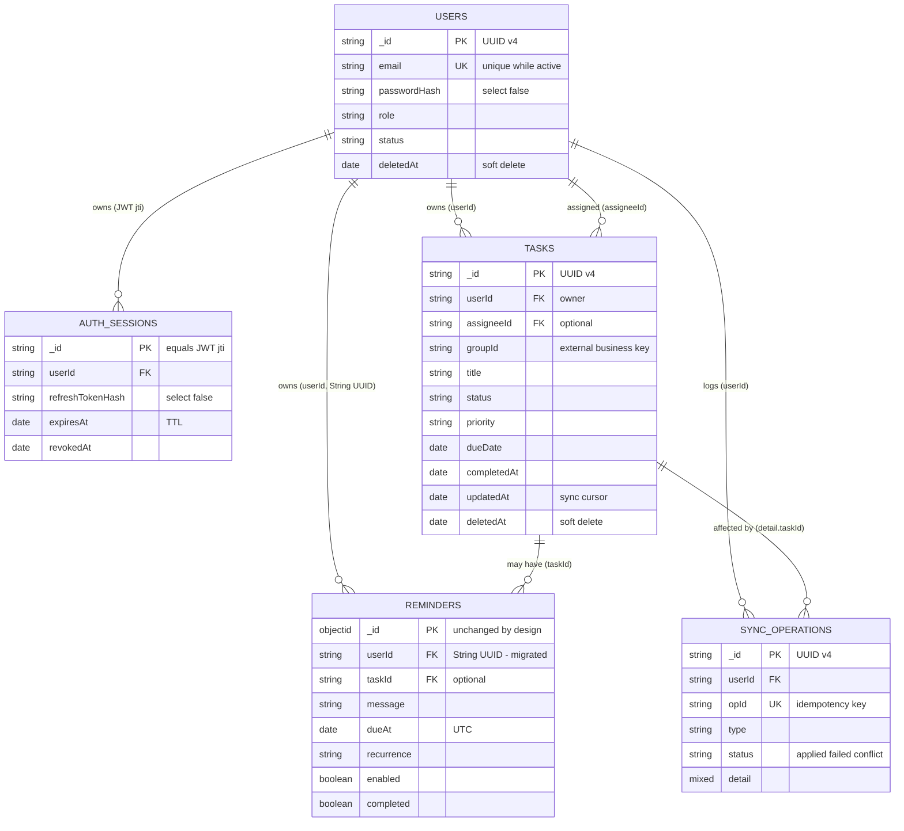

# 7.5 Database Design — Current State Report

**Project:** Auxilia – Personal Secretary & Task Automation Assistant
**Database:** MongoDB Atlas · **ODM:** Mongoose · **Backend:** Node.js, Express, TypeScript
**Architecture:** Modular monolith (Controller → Service → Repository)
**Baseline:** branch `fix/database-design-improvements` (off `feature/ui-visual-polish`), commit `d5a03c2`
**Status:** reflects the database after the identifier, synchronisation, timezone and index fixes. Nothing in this report describes an unimplemented feature as complete.

---

## 7.5.0 Scope and design principles

This report documents the five collections that support Auxilia's core functionality: identity and sessions, task management, reminders, and offline synchronisation. Productivity metrics are derived from `tasks` and are **not** stored in a separate collection. Group/collaboration collections that exist elsewhere in the system (groups, members, invitations, calendar events, roadmaps, rubrics, study sessions, audit events, feedback) are outside this design's scope.

Design rules applied throughout:

1. **Identifiers.** User, task, session and sync identifiers are String UUIDs, so the same value can travel from the Flutter client through JWT claims into every collection without ObjectId conversion. `reminders.userId` has been corrected to String UUID to match `users._id`; `reminders._id` intentionally remains an ObjectId because reminders are not part of the offline sync protocol and need no client-generated identifier.
2. **Ownership.** Every owned collection carries `userId`, populated exclusively from the verified JWT subject. Ownership cannot be supplied by the client.
3. **Relationships.** MongoDB has no foreign keys. Relationships are logical references (`ObjectId`/UUID business keys) resolved in the service and repository layers; Mongoose `ref` is only a `populate()` hint.
4. **Validation.** Mongoose validators enforce field-level rules; Zod schemas enforce request-level rules; optimistic concurrency, idempotency and conflict policy are enforced in application logic.
5. **Deletion.** Users and tasks use soft deletion (`deletedAt`). The sync ledger is append-only.

---

## 7.5.1 Collection inventory

| Collection       | Purpose                                                       | Primary identifier              | Owner reference                           | Cardinality per user |
| ---------------- | ------------------------------------------------------------- | ------------------------------- | ----------------------------------------- | -------------------- |
| `users`          | Identity, credentials, verification/MFA state, account status | String UUID `_id`               | self                                      | 1                    |
| `authsessions`   | Signed-in device; JWT `jti` and refresh-token rotation        | String UUID `_id` (= JWT `jti`) | `userId`                                  | 0..n devices         |
| `tasks`          | Personal and assigned tasks, deadlines, status, priority      | String UUID `_id`               | `userId` (owner), `assigneeId` (optional) | 0..n                 |
| `reminders`      | In-app reminder schedule, optionally linked to a task         | ObjectId `_id`                  | `userId` (String UUID, corrected)         | 0..n                 |
| `syncoperations` | Idempotency/outcome ledger for offline sync pushes            | String UUID `_id`               | `userId`                                  | 0..n                 |

All five collections use `timestamps: true` (`createdAt`, `updatedAt`) and `versionKey: false`.

---

## 7.5.2 Attribute catalogue

### 7.5.2.1 `users`

| Attribute                    | Type             | Required | Default        | Constraints / validation                                                           | Description                                       |
| ---------------------------- | ---------------- | -------- | -------------- | ---------------------------------------------------------------------------------- | ------------------------------------------------- |
| `_id`                        | String (UUID v4) | Yes      | `randomUUID()` | Immutable; primary key                                                             | Referenced by every other collection.             |
| `name`                       | String           | No       | —              | `trim`, 2–80 chars                                                                 | Display name; may be omitted at sign-up.          |
| `email`                      | String           | Yes      | —              | `lowercase`, `trim`, ≤254 chars, regex; **partial unique** where `deletedAt: null` | Login identifier; one active account per address. |
| `passwordHash`               | String           | Yes      | —              | `select: false`, removed by `toJSON` transform                                     | Salted hash; plaintext never stored.              |
| `role`                       | String enum      | Yes      | `"user"`       | `["user","admin"]`                                                                 | Authorisation role; not client-settable.          |
| `status`                     | String enum      | Yes      | `"pending"`    | `["active","disabled","pending"]`                                                  | Administrative account state.                     |
| `emailVerifiedAt`            | Date \| null     | No       | `null`         | —                                                                                  | Verification timestamp.                           |
| `emailVerificationTokenHash` | String \| null   | No       | `null`         | `select: false`; sparse index                                                      | Hash only.                                        |
| `emailVerificationExpiresAt` | Date \| null     | No       | `null`         | —                                                                                  | Token expiry.                                     |
| `mfaEnabled`                 | Boolean          | No       | `false`        | —                                                                                  | TOTP enrolment flag.                              |
| `mfaSecretEncrypted`         | String \| null   | No       | `null`         | `select: false`                                                                    | Encrypted TOTP secret.                            |
| `mfaPendingSecretEncrypted`  | String \| null   | No       | `null`         | `select: false`                                                                    | Secret awaiting confirmation.                     |
| `mfaPendingExpiresAt`        | Date \| null     | No       | `null`         | —                                                                                  | Pending enrolment expiry.                         |
| `mfaRecoveryCodeHashes`      | String[]         | No       | `[]`           | `select: false`                                                                    | Hashed recovery codes.                            |
| `mfaLastUsedStep`            | Number \| null   | No       | `null`         | `select: false`                                                                    | Last accepted TOTP counter (replay guard).        |
| `mfaEnabledAt`               | Date \| null     | No       | `null`         | —                                                                                  | Enrolment completion time.                        |
| `passwordResetTokenHash`     | String \| null   | No       | `null`         | `select: false`                                                                    | Hash only.                                        |
| `passwordResetExpiresAt`     | Date \| null     | No       | `null`         | —                                                                                  | Reset token expiry.                               |
| `lastLoginAt`                | Date \| null     | No       | `null`         | —                                                                                  | Last successful login.                            |
| `deletedAt`                  | Date \| null     | No       | `null`         | Soft-delete marker; drives partial unique email                                    | Excluded from normal queries.                     |
| `failedLoginAttempts`        | Number           | No       | `0`            | `min: 0`                                                                           | Brute-force counter.                              |
| `lockoutUntil`               | Date \| null     | No       | `null`         | —                                                                                  | Temporary lock expiry.                            |
| `createdAt`, `updatedAt`     | Date             | Yes      | Generated      | `timestamps: true`                                                                 | Lifecycle timestamps.                             |

**Structure:** all scalar or bounded value arrays; no embedded documents. `strict: "throw"` rejects unknown fields, and a `toJSON` transform strips all security attributes.

### 7.5.2.2 `authsessions`

| Attribute                  | Type           | Required | Default                  | Constraints / validation            | Description                                |
| -------------------------- | -------------- | -------- | ------------------------ | ----------------------------------- | ------------------------------------------ |
| `_id`                      | String (UUID)  | Yes      | Supplied by auth service | Equals JWT `jti`; implicit unique   | Maps a token to its session in one lookup. |
| `userId`                   | String         | Yes      | —                        | Indexed; reference to `users._id`   | Session owner.                             |
| `refreshTokenHash`         | String \| null | No       | `null`                   | `select: false`                     | SHA-256 of current refresh secret.         |
| `previousRefreshTokenHash` | String \| null | No       | `null`                   | `select: false`                     | Previous secret for reuse detection.       |
| `refreshedAt`              | Date \| null   | No       | `null`                   | —                                   | Start of rotation grace window.            |
| `userAgent`                | String \| null | No       | `null`                   | ≤255 chars                          | Device description.                        |
| `lastUsedAt`               | Date           | No       | `Date.now`               | —                                   | Last authenticated request.                |
| `expiresAt`                | Date           | Yes      | —                        | TTL index (`expireAfterSeconds: 0`) | Automatic session expiry.                  |
| `revokedAt`                | Date \| null   | No       | `null`                   | —                                   | Explicit logout marker.                    |
| `createdAt`, `updatedAt`   | Date           | Yes      | Generated                | `timestamps: true`                  | Lifecycle timestamps.                      |

### 7.5.2.3 `tasks`

| Attribute                | Type             | Required | Default        | Constraints / validation                                              | Description                                          |
| ------------------------ | ---------------- | -------- | -------------- | --------------------------------------------------------------------- | ---------------------------------------------------- |
| `_id`                    | String (UUID v4) | Yes      | `randomUUID()` | Immutable; client may supply UUID on create                           | Task identifier; offline idempotency key.            |
| `userId`                 | String           | Yes      | —              | Immutable; reference to `users._id`                                   | Owner from JWT, never from request body.             |
| `title`                  | String           | Yes      | —              | `trim`, 1–150 chars                                                   | Task title.                                          |
| `description`            | String \| null   | No       | `null`         | ≤5000 chars                                                           | Longer description.                                  |
| `course`                 | String           | No       | `""`           | `trim`, ≤120 chars                                                    | Course/module label.                                 |
| `tags`                   | String[]         | No       | `[]`           | Application: ≤8 tags, ≤24 chars each, case-insensitive de-duplication | Embedded label values.                               |
| `groupId`                | String \| null   | No       | `null`         | External group business key                                           | Optional group workspace.                            |
| `assigneeId`             | String \| null   | No       | `null`         | Reference to `users._id`                                              | Optional assigned member; included in change feed.   |
| `assigneeName`           | String \| null   | No       | `null`         | `trim`, ≤120 chars                                                    | Deliberate denormalisation for offline rendering.    |
| `reminderAt`             | Date \| null     | No       | `null`         | —                                                                     | Inline reminder hint.                                |
| `status`                 | String enum      | Yes      | `"todo"`       | `["todo","in_progress","completed","archived"]`                       | Lifecycle state.                                     |
| `priority`               | String enum      | Yes      | `"medium"`     | `["low","medium","high","urgent"]`                                    | User-selected priority.                              |
| `dueDate`                | Date \| null     | No       | `null`         | —                                                                     | Dashboard/overdue queries.                           |
| `completedAt`            | Date \| null     | No       | `null`         | Maintained by save/update hooks                                       | Set on transition to `completed`, cleared otherwise. |
| `deletedAt`              | Date \| null     | No       | `null`         | `select: false`; removed from `toJSON`                                | Soft deletion; exported by the sync feed.            |
| `createdAt`, `updatedAt` | Date             | Yes      | Generated      | `timestamps: true`                                                    | `updatedAt` is the sync cursor and CAS token.        |

### 7.5.2.4 `reminders` (post-migration)

| Attribute                | Type              | Required | Default              | Constraints / validation                   | Description                                    |
| ------------------------ | ----------------- | -------- | -------------------- | ------------------------------------------ | ---------------------------------------------- |
| `_id`                    | ObjectId          | Yes      | Generated by MongoDB | Primary key; unchanged by design           | No client-generated reminder IDs are required. |
| `userId`                 | **String (UUID)** | Yes      | —                    | `ref: "User"`; **corrected from ObjectId** | Owner; now type-compatible with `users._id`.   |
| `taskId`                 | String \| null    | No       | `null`               | UUID of `tasks._id`; no single-field index | Optional task link.                            |
| `message`                | String            | Yes      | —                    | `trim`, ≤500 chars                         | Reminder text.                                 |
| `dueAt`                  | Date              | Yes      | —                    | UTC instant                                | Scheduled time.                                |
| `recurrence`             | String enum       | No       | `"none"`             | `["none","daily","weekly","monthly"]`      | Recurrence rule.                               |
| `enabled`                | Boolean           | No       | `true`               | —                                          | Snooze/deactivate without deletion.            |
| `completed`              | Boolean           | No       | `false`              | —                                          | Handled flag.                                  |
| `completedAt`            | Date              | No       | —                    | —                                          | Completion time.                               |
| `createdAt`, `updatedAt` | Date              | Yes      | Generated            | `timestamps: true`                         | Lifecycle timestamps.                          |

**Recurrence behaviour.** `nextOccurrence()` advances the schedule with UTC date arithmetic (`setUTCDate`/`setUTCMonth`), so the stored instant does not shift with the server's timezone or DST. Completing a recurring reminder checks for an existing future occurrence of the same series before creating the next one, preventing duplicates. Policy for missed/offline occurrences and push-delivery records remain **future enhancements**.

### 7.5.2.5 `syncoperations`

| Attribute                | Type          | Required | Default        | Constraints / validation                      | Description                                                 |
| ------------------------ | ------------- | -------- | -------------- | --------------------------------------------- | ----------------------------------------------------------- |
| `_id`                    | String (UUID) | Yes      | `randomUUID()` | Primary key                                   | Ledger entry identifier.                                    |
| `userId`                 | String        | Yes      | —              | Part of compound unique key                   | Owner from JWT.                                             |
| `opId`                   | String (UUID) | Yes      | —              | Compound unique with `userId`; Zod UUID       | Client idempotency key.                                     |
| `type`                   | String enum   | Yes      | —              | `["task.create","task.update","task.delete"]` | Operation kind.                                             |
| `status`                 | String enum   | Yes      | —              | `["applied","failed","conflict"]`             | Outcome; `failed` may be retried.                           |
| `detail`                 | Mixed (JSON)  | No       | `null`         | No secrets                                    | Result payload, e.g. `{ taskId, updatedAt }` or `{ code }`. |
| `createdAt`, `updatedAt` | Date          | Yes      | Generated      | `timestamps: true`                            | `updatedAt` guards retry CAS.                               |

**Change-feed attributes.** The sync response returns task changes with `deletedAt` (Date or null) **and** the derived boolean `isDeleted`, so offline clients can distinguish an active update from a deletion without interpreting the timestamp.

---

## 7.5.3 Relationships

| Relationship                   | Type                 | Implementation                         | Cardinality | Integrity owner                                        |
| ------------------------------ | -------------------- | -------------------------------------- | ----------- | ------------------------------------------------------ |
| `users` → `authsessions`       | One-to-many          | `authsessions.userId` String reference | 1 : 0..n    | Auth service; queries scoped by JWT `userId`.          |
| `users` → `tasks` (ownership)  | One-to-many          | `tasks.userId`, immutable String       | 1 : 0..n    | Task repository applies `{ userId, deletedAt: null }`. |
| `users` → `tasks` (assignment) | One-to-many optional | `tasks.assigneeId` String              | 1 : 0..n    | Task service; change feed uses `$or`.                  |
| `tasks` → `reminders`          | One-to-many optional | `reminders.taskId` String              | 1 : 0..n    | Reminder service; ownership checked before linking.    |
| `users` → `reminders`          | One-to-many          | `reminders.userId` String (corrected)  | 1 : 0..n    | Reminder repository scopes by authenticated user.      |
| `users` → `syncoperations`     | One-to-many          | `syncoperations.userId` String         | 1 : 0..n    | Sync service; `userId` from JWT.                       |
| `syncoperations` → `tasks`     | Logical, indirect    | `detail.taskId` only                   | n : 0..1    | Not a database reference.                              |



_Notation:_ `||` = exactly one, `o{` = zero or many. `UK` on `opId` is compound with `userId`.

---

## 7.5.4 Constraints and integrity rules

### Database / Mongoose-enforced

| Collection       | Constraints                                                                                                                                                                                                             |
| ---------------- | ----------------------------------------------------------------------------------------------------------------------------------------------------------------------------------------------------------------------- |
| `users`          | Immutable String UUID `_id`; required format-valid email; partial unique active email; enum role/status; `min: 0` failed attempts; `select: false` + `toJSON` stripping of secrets; `strict: "throw"`.                  |
| `authsessions`   | Required String `_id` (= JWT `jti`) and `expiresAt`; TTL expiry; hidden token hashes; `userAgent` ≤255 chars.                                                                                                           |
| `tasks`          | Immutable `_id` and `userId`; title 1–150; description ≤5000; course ≤120; enum status/priority with defaults; `select: false` + `toJSON` removal of `deletedAt`; `completedAt` maintained by hooks; `strict: "throw"`. |
| `reminders`      | String required `userId` with `ref: "User"`; message required ≤500; `dueAt` required; enum recurrence; defaults for enabled/completed; compound indexes.                                                                |
| `syncoperations` | Compound unique `(userId, opId)`; enum `type` and `status`; UUID `_id` default.                                                                                                                                         |

### Application-level (Zod + services/repositories)

- **Ownership:** `userId` always from JWT; every task/reminder/sync query is user-scoped; task owner/assignee verified before mutation.
- **Identifiers:** UUID validation for task, assignee, reminder link and sync `opId`; Zod request schemas.
- **Tags:** ≤8 tags, ≤24 chars each, trimmed and case-insensitively de-duplicated before persistence.
- **Concurrency:** `expectedUpdatedAt` compare-and-swap; mismatch → `409 TASK_CONFLICT`.
- **Sync idempotency:** duplicate `(userId, opId)` returns the stored result; unique-index error `11000` is treated as a replay.
- **Sync retry:** a `failed` entry may be retried with the same `opId`; the ledger update uses a CAS on `updatedAt`. `applied` and `conflict` are terminal — a conflict must be resolved explicitly and retried with a new `opId`. Retried results carry `retried: true`.
- **Deletion:** users/tasks are soft-deleted; sync feed exports soft-deleted tasks with `deletedAt` and `isDeleted: true`; ledger entries are never mutated except on an authorised retry of a `failed` result.

---

## 7.5.5 Indexing strategy (current)

| Collection       | Index                                                     | Type                          | Optimised operation                          | Status                     |
| ---------------- | --------------------------------------------------------- | ----------------------------- | -------------------------------------------- | -------------------------- |
| `users`          | `{ email: 1 }`, partial `{ deletedAt: null }`             | Unique, partial               | Login, registration uniqueness               | Required                   |
| `users`          | `{ emailVerificationTokenHash: 1 }`                       | Sparse                        | Verification lookup                          | Required                   |
| `users`          | `{ status: 1, createdAt: -1 }`                            | Compound                      | Admin status list                            | Optional                   |
| `users`          | `{ role: 1, createdAt: -1 }`                              | Compound                      | Admin role list                              | Optional                   |
| `tasks`          | `{ userId: 1, deletedAt: 1, createdAt: -1 }`              | Compound                      | Default task listing                         | Required                   |
| `tasks`          | `{ userId: 1, deletedAt: 1, status: 1, dueDate: 1 }`      | Compound                      | Dashboard status/due filters                 | Required                   |
| `tasks`          | `{ userId: 1, deletedAt: 1, priority: 1, createdAt: -1 }` | Compound                      | Priority-filtered listing                    | Optional                   |
| `tasks`          | `{ userId: 1, title: "text", description: "text" }`       | Text (10/2 weights)           | User-scoped search                           | Required if search enabled |
| `tasks`          | `{ userId: 1, updatedAt: -1 }`                            | Compound                      | Change feed — owned tasks                    | Required (added)           |
| `tasks`          | `{ assigneeId: 1, updatedAt: -1 }`                        | Compound                      | Change feed — assigned tasks                 | Required (added)           |
| `reminders`      | `{ userId: 1, dueAt: 1 }`                                 | Compound                      | Upcoming reminders                           | Optional                   |
| `reminders`      | `{ userId: 1, completed: 1, dueAt: 1 }`                   | Compound                      | Open/completed lists                         | Required                   |
| `reminders`      | `{ userId: 1, enabled: 1, dueAt: 1 }`                     | Compound                      | Scheduler scan                               | Required                   |
| `reminders`      | `{ taskId: 1, userId: 1 }`                                | Compound                      | Reminders for a task                         | Required                   |
| `reminders`      | ~~`{ taskId: 1 }`~~                                       | —                             | Removed as redundant with the compound index | Removed                    |
| `authsessions`   | `{ expiresAt: 1 }`                                        | TTL (`expireAfterSeconds: 0`) | Session expiry                               | Required                   |
| `authsessions`   | `{ userId: 1, createdAt: -1 }`                            | Compound                      | Device list                                  | Optional                   |
| `syncoperations` | `{ userId: 1, opId: 1 }`                                  | Compound unique               | Idempotency check                            | Required                   |

Example definitions for the two new indexes:

```ts
taskSchema.index(
  { userId: 1, updatedAt: -1 },
  { name: "ix_sync_tasks_owner_updated" },
);
taskSchema.index(
  { assigneeId: 1, updatedAt: -1 },
  { name: "ix_sync_tasks_assignee_updated" },
);
```

Index additions are based on the actual change-feed query (`$or` on owner/assignee with `updatedAt > since`). Before adding any further index, capture slow queries with the Atlas Query Profiler, inspect `explain("executionStats")` for `IXSCAN` versus `COLLSCAN`, and remove overlapping indexes that show no benefit. See [DATABASE_PERFORMANCE.md](./DATABASE_PERFORMANCE.md).

---

## 7.5.6 Data-integrity operations

1. **Reminder ownership migration.** `npm run migrate:reminder-user-ids` performs a dry-run; `--apply` (with `ALLOW_REMINDER_ID_MIGRATION=true` in production) maps ObjectId `userId` values to the matching user `_id` string, backs up originals to `reminders_backup_pre_string_user_ids`, leaves unmatched reminders unchanged, and reports non-string and dangling references. This script must be executed and its validation output verified before the schema change reaches a live database.
2. **Verification performed in this change:** TypeScript typecheck, ESLint, Prettier, full backend suite (51 files, 369 tests) and focused tests for the new schema, UTC recurrence, deletion marker, replay and CAS-guarded retry all pass.

---

## 7.5.7 Explicitly deferred items

The following are **not** part of the current design and must not be reported as implemented:

- Notification-delivery records (requires push notifications to be introduced first).
- Missed/offline recurring-reminder policy beyond the current "next future occurrence" rule.
- A productivity/analytics snapshot collection (only if measured aggregation latency becomes a bottleneck).
- TTL retention on `syncoperations` and per-user preferences storage.
