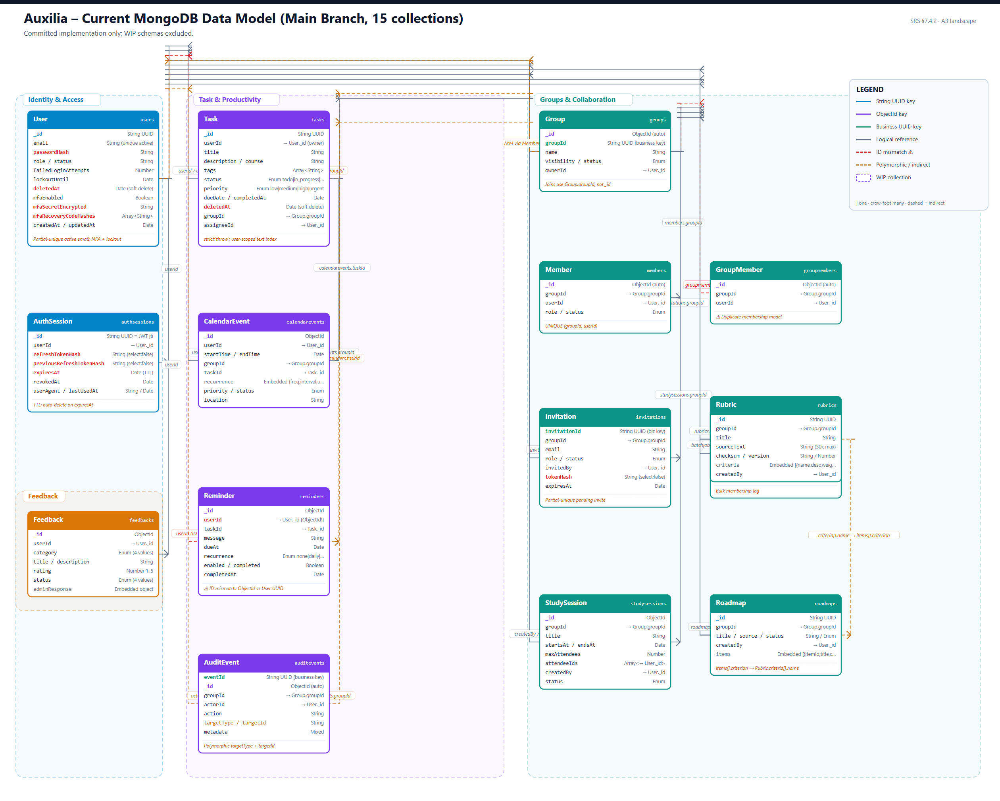
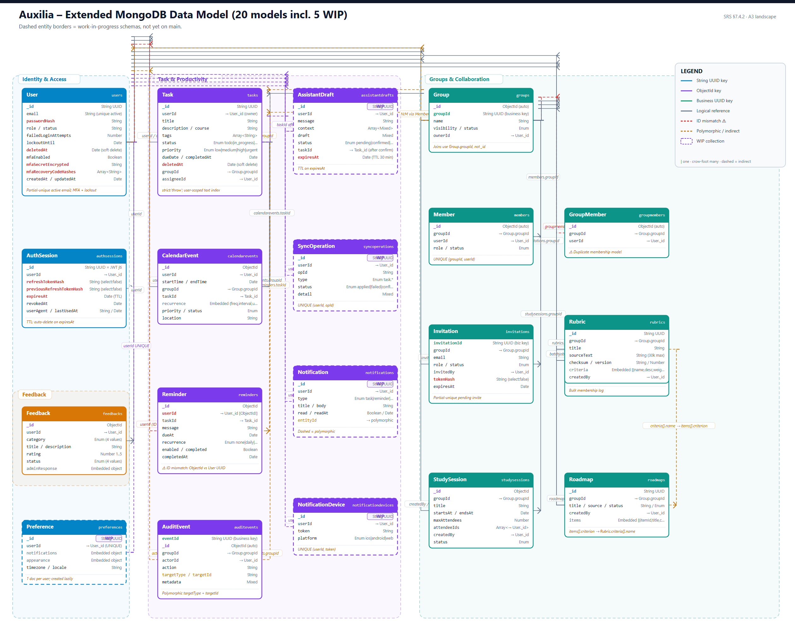

## 7.4.2 Entity Relationship Diagram (ERD)

This section documents Auxilia's MongoDB data model. Auxilia is a document-oriented application built with Node.js, Express, TypeScript and the Mongoose ODM; the Flutter/Riverpod client consumes the REST API. The database must **not** be interpreted as a relational schema: relationships are logical references managed by the service and repository layers, not database-enforced foreign keys.

Two diagrams are provided:

- **Figure 7.4.2-a — Current MongoDB Data Model:** only the 15 collections committed to `main`.
- **Figure 7.4.2-b — Extended MongoDB Data Model:** the same collections plus five work-in-progress (WIP) collections that exist in the working tree but are **not yet committed**. These are drawn with dashed entity borders and a WIP badge. The SRS must not present them as implemented functionality.

### Figure 7.4.2-a — Current MongoDB Data Model (Main Branch)

*The diagram reflects the committed database implementation only. WIP schemas are excluded.*

### Figure 7.4.2-b — Extended MongoDB Data Model (including WIP collections)

*Dashed entity borders identify the five WIP collections: AssistantDraft, Notification, NotificationDevice, Preference and SyncOperation.*

### Data model characteristics

| Characteristic | Detail |
|---|---|
| Primary identifiers | Mostly String UUIDs (e.g. `User._id`, `Task._id`); some collections use MongoDB ObjectIds (`CalendarEvent`, `Reminder`, `Feedback`, and auto `_id` side fields on Group/Member/Invitation/etc.) |
| Business identifiers | `Group.groupId`, `Invitation.invitationId`, `BatchJob.jobId`, `AuditEvent.eventId` are UUID business keys; related collections reference the business key, **not** the auto `_id` |
| Referential integrity | Logical only. A few fields carry Mongoose `ref:` hints, but most joins are performed manually by string ID; `populate()` cannot be assumed to work across all relationships |
| Embedded documents | `CalendarEvent.recurrence`, `BatchJob.errors[]`, `Roadmap.items[]`, `Rubric.criteria[]`, `Feedback.adminResponse` |
| Soft deletion | `User.deletedAt` (partial-unique active email), `Task.deletedAt` (excluded from queries) |
| TTL expiry | `AuthSession.expiresAt`, `AssistantDraft.expiresAt` (WIP) |
| Unique constraints | active user email, `Group.groupId`, `Member`/`GroupMember` `(groupId,userId)`, pending invitation `(groupId,email)`, `BatchJob.jobId`, `AuditEvent.eventId`, `Preference.userId`, `(NotificationDevice.userId, token)`, `SyncOperation(userId, opId)` |

### Domain groups and entities

| Domain | Committed entities |
|---|---|
| Identity and Access | `users`, `authsessions` |
| Task and Productivity | `tasks`, `calendarevents`, `reminders`, `auditevents` |
| Groups and Collaboration | `groups`, `members`, `groupmembers`, `invitations`, `batchjobs`, `studysessions`, `roadmaps`, `rubrics` |
| Feedback | `feedbacks` |
| Work in progress (excluded from Figure 7.4.2-a) | `assistantdrafts`, `notifications`, `notificationdevices`, `preferences`, `syncoperations` |

### Cardinality summary

- **User 1:N** AuthSession, Task (owner and assignee), CalendarEvent, Reminder, Feedback, Group (as owner), Invitation (as inviter), BatchJob (as requester), StudySession (as creator and attendee), Roadmap, Rubric, AuditEvent (as actor).
- **User N:M Group** through the `members` and `groupmembers` membership collections.
- **Group 1:N** Task, CalendarEvent, Member, GroupMember, Invitation, BatchJob, StudySession, Roadmap, Rubric, AuditEvent.
- **Task 1:N** Reminder; **Task 1:0..1** CalendarEvent; **Task 1:0..1** AssistantDraft (WIP, after confirmation).
- **Rubric 1:N Roadmap** through the embedded `criteria[].name` → `items[].criterion` text match (logical, not a collection reference).
- `AuditEvent.targetType`/`targetId` and `Notification.entityId` (WIP) are polymorphic references.

### Technical notes and warnings

1. String UUIDs and ObjectIds are visually distinguished in the diagrams (blue and purple key badges respectively).
2. `Group.groupId` is the business identifier referenced by other collections; `Group._id` is an automatically generated ObjectId and is **not** the join key.
3. `Invitation.invitationId`, `BatchJob.jobId` and `AuditEvent.eventId` are business identifiers alongside their Mongo `_id`.
4. **Data-model issue:** `Reminder.userId` is an ObjectId, whereas `User._id` is a String UUID. This inconsistency will break direct lookups/population between reminders and users and should be corrected in a future migration.
5. **Duplicate membership models:** `Member` and `GroupMember` are separate collections representing the same `(groupId,userId)` relationship. Their overlapping responsibilities require verification; both are shown separately in the ERD.
6. Polymorphic references have no database-enforced referential integrity; they are drawn with dashed connectors.
7. TTL indexes exist on `AuthSession.expiresAt` and `AssistantDraft.expiresAt` (WIP).
8. `User` and `Task` implement soft deletion via `deletedAt`.
9. The ERD does not imply that Mongoose `populate()` works for every relationship — most relationships are resolved manually in code.
10. Crow's-foot notation: `|` = exactly one, fork = many, `o` = zero; solid connectors are direct logical references, dashed connectors are polymorphic or indirect relationships.

### Source schemas

Mongoose schema files: `backend/src/modules/{users,auth,tasks,calendar,reminders,audit,groups,feedback,sessions,roadmaps,rubrics}/...model.ts` and the WIP files under `backend/src/modules/{assistant,notifications,preferences,sync}/`. The vector originals of the two figures are `docs/architecture/erd/auxilia_erd_current.svg` and `auxilia_erd_extended.svg` (A3 landscape, scalable).
