# Integrated Release Workflow (with Production CD) — Auxilia

**Status:** Target (enterprise-aligned, practical for student/free-tier delivery)  
**Last updated:** 2026-11-24  
**Scope:** How Auxilia moves from validated code to production using a **single Release Workflow** in which **Production Continuous Deployment (CD) is an integrated stage** (not a separate, disconnected pipeline).

---

## 1) Executive summary

Auxilia’s **Development CI Pipeline** remains the mandatory quality and security gate. The **Release Workflow** is the controlled delivery path that:

1. Starts from an **eligible release trigger** (version tag or approved release candidate),
2. Promotes a **single immutable artifact/SHA** that already passed CI,
3. Deploys and verifies in **staging**,
4. Enforces a **release approval/gate**,
5. Performs **Production Deployment (CD)** as an in-pipeline stage,
6. Runs **post-deployment verification** and **rollback/recovery** if needed.

This design improves traceability, reduces “drift” between environments, and makes release outcomes auditable for coursework, operations, and handover.

---

## 2) Revised CI/CD pipeline architecture (target)

### 2.1 Layers

- **Layer A — Development CI Pipeline (preserved)**
  - Source of truth for quality: PR/source conventions, security/compliance scans, backend/frontend validation, E2E, quality gates, optional performance checks.
  - **No production deployment** is performed as part of normal merge-to-main side effects inside the Release Workflow model; production delivery happens only through the Release Workflow (or an explicitly documented break-glass procedure).

- **Layer B — Release Workflow (integrated)**
  - Orchestrates the full lifecycle: trigger → artifact promotion → staging deploy → staging verification → approval → **Production CD** → post-deploy verification → rollback/recovery.
  - **Production CD is inside this workflow** (a first-class stage with dependencies and failure paths), not a separate automation that “just happens” elsewhere.

- **Layer C — Environments & configuration**
  - **CI**: ephemeral runners, mocked/externalized services as appropriate.
  - **Staging**: production-like topology and config surface, isolated secrets/URLs (e.g. Render staging services), used only for release candidates.
  - **Production**: gated environment with protected secrets, monitored runtime, strict change control.

### 2.2 Artifact and promotion model (no unnecessary rebuilds)

- The **release candidate identity** is the **commit SHA** (and optionally immutable container image digests) that passed CI.
- The pipeline **promotes the same artifact** to staging and then to production:
  - Preferred: deploy by **exact SHA** via platform API (e.g. Render Deploy API) to staging, then to production after approval.
  - Alternative when using containers: deploy **immutable GHCR images by digest** built for that SHA.
- Release distribution artifacts (e.g. web tarball, SBOM, provenance/attestations) are generated during the Release Workflow from the same source/tag for audit and supply-chain traceability.

### 2.3 Deployment strategy (practical for Auxilia / free-tier hosting)

- Default: **controlled promotion** of the same verified artifact through staging then production with health gates and smoke tests (a safe, progressive delivery pattern appropriate to Render/free tiers).
- **Rolling/progressive behavior** is achieved via platform-managed deploys and strict health verification; **blue-green** is documented as an **optional future enhancement** if two parallel production-grade services are operated (not required now due to cost/complexity).
- Concurrency controls prevent overlapping production deploys/rollbacks.

### 2.4 Security, secrets, and compliance (enterprise-minded, right-sized)

- Secrets and environment variables are stored in **GitHub Environments** and platform secret managers (never in git).
- Production requires: `NODE_ENV=production`, explicit `CORS_ORIGIN`, strong `JWT_SECRET`, and validated runtime configuration at startup (as enforced by the application).
- Least-privilege credentials (e.g. Render API tokens scoped to deploy operations where possible).
- Supply-chain artifacts (SBOM/provenance) are produced for releases; vulnerability findings are triaged and documented per release policy.

---

## 3) Complete stage-by-stage workflow (Release Workflow)

> **Normative flow:** CI success → Release Trigger → Artifact Promotion → Staging Deployment → Staging Verification → Release Approval/Gate → **Production Deployment (CD)** → Post-Deployment Verification → Rollback/Recovery (on failure).

### Stage 1 — Release Trigger
- **When:** After successful CI for the intended baseline and an eligible release event:
  - Push of a version tag `vX.Y.Z`, **or**
  - Manual “Run Release Workflow” dispatch for an approved release candidate (referencing a reviewed SHA and change record).
- **Guardrails:** version/tag consistency (`backend/package.json`, `frontend/pubspec.yaml`, tag), branch protection satisfied, no unresolved critical CI failures.

### Stage 2 — Artifact Promotion
- Resolve immutable **release candidate** = `commit_sha` (and image digests if applicable).
- Produce and publish traceable outputs from the same candidate:
  - Web build artifact (e.g. `auxilia-web-<tag>.tar.gz`)
  - SBOM (e.g. Syft, SPDX JSON)
  - Build provenance/attestations (as adopted)
  - Ensure immutable images exist for the SHA if container promotion is used
- **Rule:** **No rebuild** for staging/production promotion; promote the same artifacts/SHA.

### Stage 3 — Staging Deployment
- Deploy the same candidate to **staging** (separate services, staging secrets/config).
- Use pinned SHA deploys (preferred) with concurrency locks.
- Record deployment metadata (SHA, actor, timestamp, environment) in workflow summaries/logs.

### Stage 4 — Staging Verification
- Automated verification against staging:
  - Health: `GET /api/health` → 200
  - Smoke: `scripts/smoke-test.mjs` (non-mutating checks aligned to policy)
  - Optional targeted integration checks (critical journeys) as defined by the team
- **On failure:** stop the workflow; **do not** proceed to approval/production. Open incident notes; produce a new candidate only after fixes and CI success.

### Stage 5 — Release Approval / Gate
- Enforced via **GitHub Environments** protection (required reviewers) for `production` (and optionally a dedicated `release` environment).
- Approval confirms: staging passed, change documentation/checklist items satisfied, and go/no-go decision is recorded.

### Stage 6 — Production Deployment (CD) — **integrated**
- Executes only after approval.
- Deploy the **same verified** SHA/digest to production using environment-scoped secrets.
- Practices: concurrency (`cancel-in-progress: false`), auditable logs, no rebuild, clear “what was deployed” trace.
- **On failure (deploy/apply):** enter Rollback/Recovery.

### Stage 7 — Post-Deployment Verification
- Bounded health polling (e.g. repeated checks up to an agreed timeout for cold starts).
- Production smoke tests (`scripts/smoke-test.mjs` against production URL).
- Record results in workflow summary; link operational dashboards/runbooks.
- **On failure:** enter Rollback/Recovery.

### Stage 8 — Rollback / Recovery
- **Automatic (recommended):** on production deploy or post-deploy verification failure, trigger rollback to `LAST_GOOD_SHA` (or last recorded known-good) using the same pinned-deploy mechanism, then re-verify with smoke tests.
- **Manual:** `workflow_dispatch` rollback with reason, environment, and verification steps (audit trail).
- If rollback fails: follow incident runbook, halt further automated promotions, document outcomes.

---

## 4) Responsibilities and purpose of each stage

| Stage | Primary owner(s) | Purpose |
|---|---|---|
| Release Trigger | Release manager + automation | Bind release to an eligible, approved candidate and version |
| Artifact Promotion | Release/CI automation | One-time, traceable build of release artifacts from validated SHA |
| Staging Deployment | Automation + platform ops | Prove deployability and config in staging using the real path |
| Staging Verification | QA + automation | Block bad candidates before production |
| Release Approval / Gate | Authorized approvers | Human accountability and change control checkpoint |
| Production Deployment (CD) | Automation + platform ops | Safe, repeatable delivery of approved artifact to users |
| Post-Deployment Verification | QA + automation + on-call | Confirm production health and critical behavior |
| Rollback / Recovery | DevOps/on-call + automation | Restore service quickly to known-good; preserve evidence |

Cross-cutting: least privilege, environment separation, pinned tooling where feasible, structured summaries, and updates to runbooks/checklists when process changes.

---

## 5) Relationship between CI, release management, and CD

- **CI** is the **quality/security gate** for all candidate changes. No release candidate should advance without CI success for that lineage.
- **Release management** defines **what/when** to release (versioning, tags, notes, approvals, governance). It consumes CI evidence and staging results, then authorizes production progression.
- **CD** is the **automated delivery mechanism** executed **inside the Release Workflow**: staging first, then production after approval, followed by verification and rollback. It does **not** depend on an unrelated “deploy on every merge to main” narrative as the release truth; the **Release Workflow** is the auditable delivery record.
- **Connection (target):** Dev/PR → CI green → merge policy → Release Trigger → Artifact Promotion (same SHA) → Staging Deploy/Verify → Approval → **Production CD** → Post-deploy Verify → success or Rollback/Recovery.

---

## 6) Justification for integrating Production CD within the Release Workflow

1. **Traceability:** one release identity (tag/SHA) ties together artifacts, staging evidence, approval, production deploy, and verification.
2. **Same artifact promotion:** eliminates rebuild-induced drift between staging and production.
3. **Explicit control points:** staging verification + environment approvals create a defendable release process for academic and practical governance.
4. **Operational clarity:** a single pipeline/story replaces fragmented workflows that are hard to correlate during incidents.
5. **Right-sized engineering:** leverages existing GitHub/Render primitives (environments, Deploy API, smoke scripts) without requiring enterprise Kubernetes complexity for a student/free-tier project.
6. **Faster recovery:** rollback is defined as part of the release lifecycle with known-good references and verification steps.

---

## 7) Mermaid diagram (Markdown-renderable; adaptable to draw.io)

```mermaid
flowchart TD
  subgraph CI["Development CI Pipeline (preserved)"]
    A["Push / PR / manual\n(feature, fix, release/*, main, develop)"] --> B["PR & source control gates\n(conventions, branch rules)"]
    B --> C["Security & compliance\n(Trivy FS/image, Gitleaks, CodeQL)"]
    C --> D{"Required CI checks\npass?"}
    D -- "No" --> X1["Fail CI\n(block merge/release progression)"]
    D -- "Yes" --> E["Parallel validation\nBackend: lint, typecheck, tests, coverage, build, prod audit\nFrontend: format, analyze, tests, coverage, web build"]
    E --> F["E2E (Docker Compose + Playwright)"]
    F --> G["Quality gates\n(Sonar/summary) + optional perf (workflow_dispatch)"]
    G --> H{"CI Final Quality Gate\n= success?"}
    H -- "No" --> X1
    H -- "Yes" --> I["Trusted candidate SHA\n(eligible for Release Workflow)"]
  end

  subgraph RW["Release Workflow (integrated — includes Production CD)"]
    I --> J["Release Trigger\nTag vX.Y.Z or approved RC dispatch\n(version/tag consistency, change approved)"]
    J --> K{"Trigger valid?"}
    K -- "No" --> X2["Stop: fix versioning/approvals"]

    K -- "Yes" --> L["Artifact Promotion\nBuild/package once from same SHA\n(web tarball, SBOM, provenance)\nPublish immutable images/digests if used\nAttach to GitHub Release"]
    L --> M["Staging Deployment\nDeploy same SHA/digest to staging\n(environment-scoped secrets)"]
    M --> N{"Staging deploy\nsucceeded?"}
    N -- "No" --> R1["Stop / recovery path\n(no production change)\nInvestigate; new candidate after CI"]

    N -- "Yes" --> O["Staging Verification\nGET /api/health, smoke-test.mjs,\noptional integration checks"]
    O --> P{"Staging verification\npassed?"}
    P -- "No" --> R1

    P -- "Yes" --> Q["Release Approval / Gate\nGitHub Environment reviewers\nchange record/checklist confirmed"]
    Q --> S{"Approved?"}
    S -- "No / timeout" --> X3["Held/cancelled\n(no production deploy)"]

    S -- "Yes" --> T["Production Deployment (CD)\nDeploy same verified SHA/digest to production\n(concurrency lock; no rebuild)\nPractical: rolling/progressive promotion via platform"]
    T --> U{"Production deploy\napplied?"}
    U -- "No" --> R2["Rollback / Recovery\nAuto or manual rollback to LAST_GOOD_SHA\nthen verify"]

    U -- "Yes" --> V["Post-Deployment Verification\nBounded health polling\nProduction smoke tests\nRecord status/monitoring links"]
    V --> W{"Post-deploy checks\npassed?"}
    W -- "No" --> R2

    W -- "Yes" --> Y["Release complete\nProduction verified; trace retained\nUpdate notes/checklists/runbooks as needed"]

    R1 --> Z["Notify team; incident notes\nFix forward with new CI-validated candidate"]
    R2 --> AA["Re-run smoke after rollback\nConfirm recovery; incident review\nAdjust LAST_GOOD_SHA/process if needed"]
  end

  style CI fill:#f8fafc,stroke:#64748b,color:#0f172a
  style RW fill:#f0fdf4,stroke:#16a34a,color:#052e16
```

---

## 8) Recommended implementation mapping (to existing repo workflows)

| Target stage | Current repo touchpoints (today) | Recommended direction |
|---|---|---|
| CI validation | `.github/workflows/ci.yml` | **Keep as-is** (preserve stages/gates). |
| Release trigger + artifacts | `.github/workflows/release.yml` | Extend into **Release Workflow** (or orchestrate) so tag/release also drives staging→prod promotion of the same SHA, while keeping artifact/SBOM/provenance publishing. |
| Staging deploy/verify | `.github/workflows/promote.yml` (staging path) | Reuse as callable jobs/steps inside Release Workflow with strict “same SHA” input. |
| Production CD | `.github/workflows/deploy-production.yml` (triggered after CI on main) | **Integrate** into Release Workflow after approval; reduce reliance on “deploy-after-CI-on-main” as the only prod path for releases (keep as emergency/hotfix policy if documented). |
| Rollback | `.github/workflows/rollback.yml` | Keep as manual + called by automated recovery steps in Release Workflow. |
| Immutable images | `.github/workflows/publish-image.yml` | Continue publishing SHA-tagged images/digests for promotion. |

> **Note:** This document defines the **target architecture and process**. Workflow YAML refactoring should be done in a follow-up change with environment protection rules, secrets audit, and a staging rehearsal (per `docs/deployment/CICD_CONFIGURATION.md`).

---

## 9) Related documents

- `docs/deployment/CICD_CONFIGURATION.md`
- `docs/deployment/DEPLOYMENT_PLAN.md`
- `docs/deployment/ROLLBACK_RUNBOOK.md` (if present)
- `docs/release/RELEASE_CHECKLIST.md`
- `docs/operations/MONITORING_RUNBOOK.md`
- `docs/compliance/NFR_RELEASE_GATES.md`